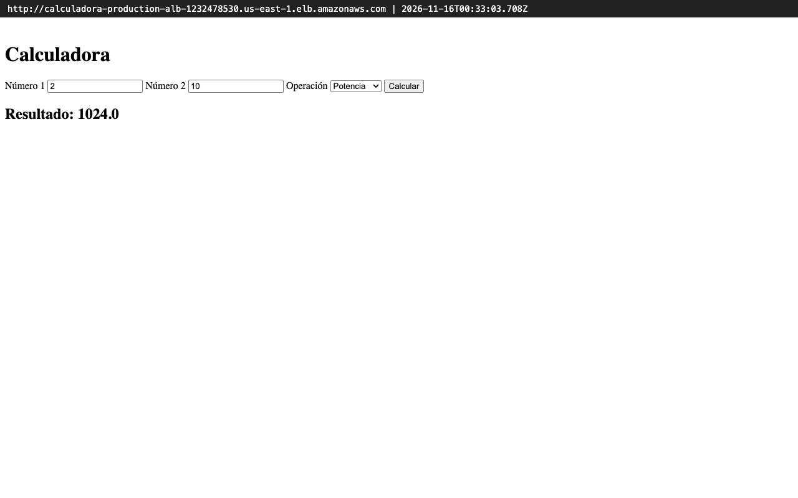
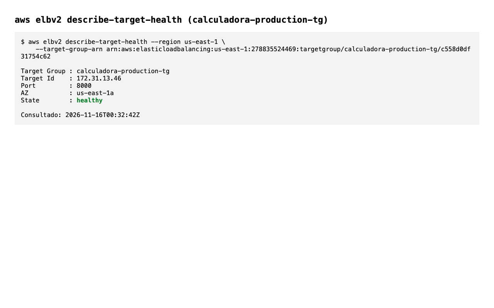

# cicd-pipeline-python-cd

Taller Entregable 3 del curso Integración y Entrega Continua de Software (SI6008), Universidad EAFIT.

Pipeline de CI/CD para una calculadora web en Flask. Parte del CI del Taller 2 y agrega despliegue continuo a Staging y Producción en AWS ECS (Fargate) con Terraform.

## Integrantes

Texto usado en `AUTOR`: `Sergio Alfredo Junca Valero | Valeria Cardona Urrea`

| Nombre completo | Usuario de GitHub | Rol |
|---|---|---|
| Sergio Alfredo Junca Valero | [sjunka](https://github.com/sjunka) | Propietario del repositorio |
| Valeria Cardona Urrea | [valri2104](https://github.com/valri2104) | Colaboradora |

## Evidencias

- Ejecución del pipeline del merge de las nuevas funciones (5 jobs en verde, con la aprobación de Producción): https://github.com/sjunka/cicd-pipeline-python-cd/actions/runs/43778738429
- Pull Request de las nuevas funciones: https://github.com/sjunka/cicd-pipeline-python-cd/pull/1
- URLs de los ALB:

```plaintext
Staging:    http://calculadora-staging-alb-318186033.us-east-1.elb.amazonaws.com
Production: http://calculadora-production-alb-1232478530.us-east-1.elb.amazonaws.com
```

- Capturas. La primera es la calculadora en Producción con 2 potencia 10 = 1024. La segunda es la salida de `aws elbv2 describe-target-health` para `calculadora-production-tg` (no es una captura de la consola): el único target aparece `healthy`.




## Respuestas

### 1. Flujo completo

Cada push a `main` (que no sea solo documentación) dispara `ci-cd.yml`.

- `build-and-test`: corre black, pylint y flake8, las pruebas unitarias y de componente con cobertura mínima de 80%, y el análisis de SonarCloud. Construye la imagen Docker, la levanta en el runner y le corre las pruebas de aceptación con Selenium. Si todo pasa, publica la imagen en Docker Hub con dos etiquetas: `latest` y el SHA del commit. Deja como salida `image_uri` (`sjunka/cicd-pipeline-python-cd:<SHA>`).
- `deploy-staging`: con las credenciales de AWS corre `terraform apply` en el workspace `staging` pasando ese `image_uri` y el SHA como `app_version`. Terraform crea o actualiza el ALB, el target group, el cluster y el servicio ECS. Deja como salida la URL del ALB.
- `test-staging`: espera a que `/health` del ALB de staging devuelva el SHA nuevo y corre las pruebas de aceptación con Selenium contra esa URL.
- Aprobación: el job `deploy-production` usa el ambiente `production`, que tiene revisores requeridos. Se queda esperando hasta que un integrante lo aprueba.
- `deploy-production`: el mismo `terraform apply` en el workspace `production` con la misma imagen que se probó en staging. No se vuelve a construir nada.
- `smoke-test-production`: espera el SHA en `/health` de producción y corre las pruebas de humo (la página carga y `/health` responde `ok` con la versión esperada).

El artefacto que se mueve entre jobs es la imagen con etiqueta de SHA. Es la misma de punta a punta.

### 2. Terraform vs consola

Ventajas: la infra queda escrita y versionada en el repo, se repite igual en staging y producción (solo cambia el workspace), `plan` muestra qué va a cambiar antes de hacerlo y `destroy` borra todo sin olvidar recursos que sigan cobrando.

Desventajas: hay que aprender HCL y el modelo de estado, y un error de configuración se replica en ambos ambientes. Si alguien cambia algo a mano en la consola, el estado queda desalineado.

El estado va en S3 porque lo usan el pipeline y cualquier integrante. Si estuviera en un computador, el runner de GitHub no lo vería y crearía todo otra vez. El bucket tiene versionado para recuperar un estado dañado y `use_lockfile` para que dos `apply` no corran al tiempo.

### 3. Staging

Ventajas: se prueba la imagen real en una infraestructura igual a producción (ALB, ECS, health check) antes de que la vea un usuario. Fallas de configuración que no salen en el runner (puerto, variables, health check) salen ahí.

Desventajas: cuesta el doble de infraestructura y el despliegue tarda más, porque hay un apply y unas pruebas más.

Se gana seguridad a cambio de velocidad. Para este taller vale la pena porque el costo de una caída en producción es mayor que unos minutos más de pipeline.

### 4. test-staging vs smoke-test-production

En staging corren las pruebas de aceptación completas con Selenium: llenan el formulario, prueban operaciones y errores. En producción solo corren las de humo: que la página cargue y que `/health` responda con la versión correcta.

La razón es que staging es donde se valida el comportamiento. En producción ya se sabe que la versión funciona; solo se confirma que quedó desplegada y viva, rápido y sin generar tráfico de prueba con usuarios reales.

### 5. Qué le falta al pipeline

- Monitoreo y alertas: hoy solo hay logs en CloudWatch. Faltan alarmas (5xx del ALB, CPU, tareas no saludables) que avisen al equipo. Se puede hacer con alarmas de CloudWatch en Terraform y un tema de SNS.
- Análisis de seguridad de la imagen y de la IaC: el pipeline no escanea vulnerabilidades de la imagen ni malas configuraciones de Terraform. Se puede agregar Trivy para la imagen y Checkov o tfsec para `infra/` en `build-and-test`.

### 6. Experiencia de cada integrante

- Sergio Alfredo Junca Valero: Me pareció una experiencia muy útil porque permite hacer cambios con mayor confianza, sabiendo que cada etapa valida el código antes de llegar a producción. El CI/CD facilita el trabajo y reduce errores, aunque las aprobaciones manuales pueden hacer un poco más lento el proceso.
- Valeria Cardona Urrea: Fue una experiencia enriquecedora porque pude ver cómo un mismo cambio pasa por todas las etapas, desde las pruebas en el runner hasta producción, sin tener que desplegar nada a mano. Lo que más me gustó fue que staging nos dejara probar la imagen real antes de aprobarla, porque da tranquilidad al momento de pasar a producción. Lo más retador fue entender Terraform y el manejo del estado en S3, pero una vez configurado, desplegar se volvió algo repetible y mucho más confiable.

### 7. Entrega o despliegue continuo

Con la aprobación manual es Entrega Continua: todo llega solo hasta staging y queda listo para producción, pero una persona decide cuándo pasa.

Antes de aprobar revisamos en staging que `test-staging` quedó en verde (incluye las pruebas de aceptación de potencia y módulo) y que `/health` mostraba el SHA del merge, `4ca51a6`.

Si una versión no pasa el health check, el target group nunca la marca saludable y ECS no termina el despliegue. El circuit breaker (`deployment_circuit_breaker` con `rollback = true`) lo detecta, marca el despliegue como fallido y vuelve a la última task definition que funcionaba. Como el servicio tiene `wait_for_steady_state = true`, el `terraform apply` falla y el job de despliegue queda en rojo. Además el job de pruebas nunca ve el SHA nuevo en `/health` y también falla.
